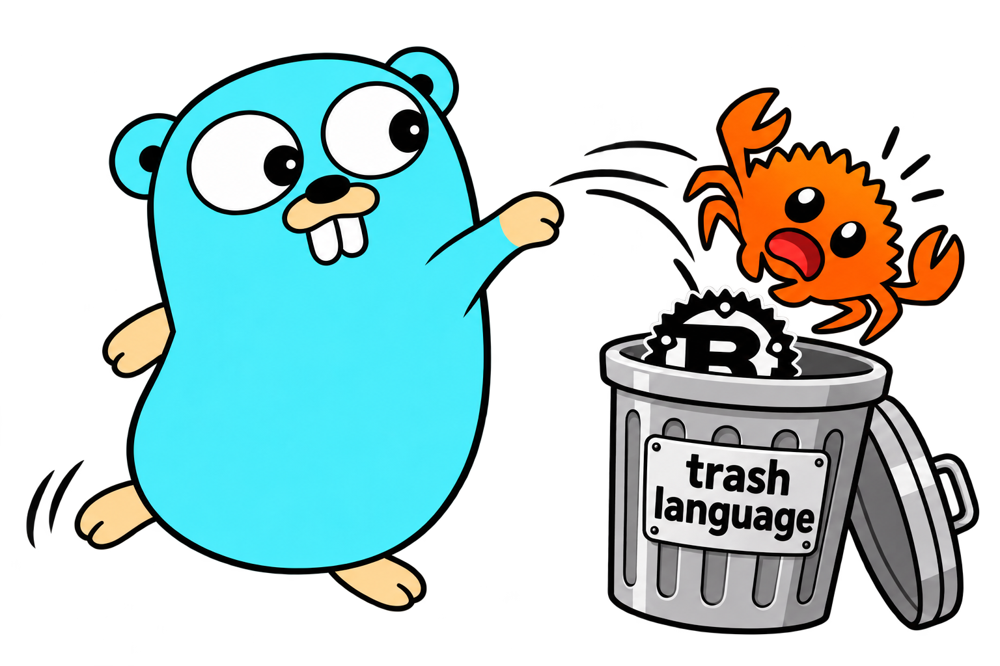

# gocpp



**Write Go, get C++.** gocpp (Go++) is a language that looks and feels like Go. You write `.gp`
files, and the `gocpp` tool translates them into readable C++20, then builds a native program with
`clang++` or `g++`. Because the output is plain C++, a `.gp` file can import any C or C++ header and
call it directly: no bindings, no cgo, no glue code.

```go
package main

import (
	"fmt"

	"<algorithm>"
	"<cmath>"
	"<vector>"
)

type Point struct{ X, Y float64 }

// Dist calls std::hypot from C++'s <cmath>.
func (p Point) Dist() float64 {
	return std.hypot(p.X, p.Y)
}

func main() {
	points := []Point{{6, 8}, {3, 4}, {5, 12}}

	dists := std.vector[float64]{}
	for _, p := range points {
		dists.push_back(p.Dist())
	}
	std.sort(dists.begin(), dists.end())

	fmt.Println("nearest:", dists.front(), "farthest:", dists.back())
}
```

```text
$ gocpp run main.gp
nearest: 5 farthest: 13
```

A Go struct, method and slice, and C++'s `std::vector`, `std::sort` and `std::hypot`, in one
file. `gocpp emit main.gp` prints the C++ that gocpp writes. The method becomes:

```cpp
double Point::Dist() const {
    Point p = *this;
    return ::std::hypot(p.X, p.Y);
}
```

## Why gocpp

- **Go you already know.** Packages, `:=`, multiple results, methods, interfaces, embedding,
  slices, maps, closures, `defer`, `panic` and `recover`, generics, goroutines, channels and
  `select`. `gocpp fmt` formats code like gofmt.
- **C and C++ without glue.** Import a header (`"<vector>"`, `"<sqlite3.h>"`, `"./engine.hpp"`)
  and use it like a package: C++ classes and templates (`std.vector[int]`), C structs, macros
  and callbacks. `.c` and `.cpp` files next to your `.gp` files are compiled into the program.
- **No garbage collector.** Memory is reference counted, so it is freed as soon as the last
  reference goes. `weak.Pointer` breaks reference cycles.
- **Safe by default.** Index, nil and division errors panic as in Go, with Go's messages, stack
  traces and exit codes. `-nochecks` turns the bounds and nil checks off for speed.
- **Readable output.** The C++ is meant to be read, and `gocpp explain` says why a line becomes
  what it does. `#line` directives point compiler errors, gdb and lldb at your `.gp` lines.
- **A little more than Go.** Must functions (`!`) return errors for you, and macros
  (`#Name(...)`, `#Derive`) write code at compile time. Code without them is plain Go, and
  `gocpp expand` prints the plain Go that they stand for.
- **One tool.** `gocpp build`, `run`, `test`, `fmt`, `vet`, `doc`, `debug` and `get`, and a
  language server built to match gopls's speed, with a VS Code extension.
- **Linux and Windows.** `gocpp.exe` runs on Windows 10 and later, and `gocpp build -os windows`
  makes a Windows program on Linux.

A must function, for example ([tour lesson](docs/tour/11-must-functions.md)):

```go
// parsePort is a must function: an error from a call inside it is returned
// for you, so its callers see func parsePort(s string) (int, error).
func parsePort!(s string) int {
	port := strconv.Atoi(s)
	if port < 1024 {
		return 0, fmt.Errorf("port %d is reserved", port)
	}
	return port
}
```

## Status

gocpp is built in phases, following [the plan](plans/2026-10-13-gocpp/README.md). Phases 00 to
08 are done: the language, C/C++ interop, packages and modules, generics and goroutines. Phases
09 to 15 are under way: the standard library and `gocpp test`, must functions and macros, the
language server, typed interop, tooling, Windows, and the hardening for v1.0. There is no release
yet ([v0.1 preparation](docs/guides/release-candidate.md)), and
[STATE.md](plans/2026-10-13-gocpp/STATE.md) has the details.

| Milestone | What it proves | |
|---|---|:---:|
| M1 | `hello.gp` runs | ✅ |
| M2 | real programs without interop | ✅ |
| M3 | any C or C++ header is usable (`sqlite`, `raylib`, the C++ standard library) | ✅ |
| M4 | projects of many packages; a rebuild with no change takes under 200 ms | ✅ |
| M5 | goroutines, channels and `select`, clean under ThreadSanitizer | ✅ |
| M6 | v0.1 for Linux: the first tier of the standard library and `gocpp test` | next |
| M7 | must functions, macros and an editor as fast as gopls | 🚧 |
| M8 | Windows works: the `win32` example and the test suites on a Windows PC | 🚧 |
| M9 | v1.0 for Linux and Windows | 🚧 |
| M10, M11 | Go modules such as gin used from gp code ([Phase 16](plans/2026-10-13-gocpp/phase-16-dual-engine/README.md)) | planned |

**What works by default.** The compiler refuses a feature of a later phase with an error that
names the phase:

```text
./main.gp:5:2: package strconv is not available yet (Phase 09)
```

The default line is the phase that `gocpp version` prints. It is still `phase 05`, so generics,
programs of several packages, C/C++ interop, must functions and macros work by default, while
goroutines (Phase 08) and most of the standard library (Phase 09) are built but behind a switch.
`GOCPP_GATE_PHASE=15` turns on everything that is built: `GOCPP_GATE_PHASE=15 gocpp run .`. The
[feature matrix](docs/spec/feature-matrix.md) gives the phase of each feature.

## Get started

Build gocpp from a checkout. You need Go 1.25 and a C++20 compiler: `g++` 13 or newer, or
`clang++` 17 or newer. With `clang++`, gocpp also asks clang for the real C and C++ types, so a
wrong call into C or C++ is an error in `gocpp check` and in the editor
([typed interop](docs/spec/typed-interop.md)). The Nix dev shell (`nix develop`) has all of it.

```sh
git clone https://github.com/huuhait/GoToCPP.git gocpp
cd gocpp
make build                  # writes bin/gocpp: put bin/ in your PATH
gocpp version
```

How a release will be installed (`go install`, archives, `nix run`) is in the
[packaging guide](docs/guides/packaging.md).

For a first program, save the example above as `main.gp` in a new folder, next to a `gocpp.mod`
that names the module. A single file runs without one, but `./...` patterns and `gocpp test`
need a module ([modules](docs/spec/modules.md)).

```sh
mkdir hello && cd hello                       # save the example as main.gp here
echo 'module example.com/hello' > gocpp.mod
gocpp run .
```

Then try the other commands:

```sh
gocpp build -release .              # an optimized program: -O2, link-time optimization
gocpp build -os windows .           # a Windows .exe, built on Linux
gocpp emit main.gp                  # print the C++
gocpp explain main.gp:15            # what a line becomes in C++, and why
gocpp fmt -w .                      # format like gofmt
gocpp check ./...                   # type-check, with errors like go build's
gocpp vet ./...                     # likely mistakes, like go vet
gocpp test ./...                    # run the tests in _test.gp files
gocpp debug .                       # build, then start gdb or lldb at the .gp level
gocpp get example.com/lib@v1.2.0    # add a dependency to gocpp.mod
```

`gocpp help` lists every command, and `gocpp <command> -h` explains one. For now, goroutines,
`_test.gp` files and most of the standard library need `GOCPP_GATE_PHASE=15`
([Status](#status)). The [examples](examples/README.md) are 19 small, real programs, from
`hello` to `sqlite`, `raylib`, goroutines and channels, and `win32`.

## How gocpp compares

gocpp sits between Go and C++: Go's syntax and tooling, with C++ as the target, so you can call C
and C++ libraries without glue code. The table is a rough guide, not a benchmark.
✅ yes, ❌ no, 🚧 being built.

| | gocpp | Go | C++ | Rust |
|---|:---:|:---:|:---:|:---:|
| Simple syntax, easy to learn | ✅ | ✅ | ❌ | ❌ |
| No garbage collector | ✅ | ❌ | ✅ | ✅ |
| Memory safe by default | ✅ | ✅ | ❌ | ✅ |
| Memory safety proven at compile time | ❌ | ❌ | ❌ | ✅ |
| Goroutines, channels and `select` | ✅ | ✅ | ❌ | ❌ |
| Millions of lightweight tasks | ❌ | ✅ | ❌ | ✅ |
| Generics | ✅ | ✅ | ✅ | ✅ |
| Call C directly, no wrapper | ✅ | ❌ | ✅ | ❌ |
| Call C++ directly, no wrapper | ✅ | ❌ | ✅ | ❌ |
| Fast builds | ❌ | ✅ | ❌ | ❌ |
| Formatter and language server included | ✅ | ✅ | ❌ | ✅ |
| One tool for build, test and packages | 🚧 | ✅ | ❌ | ✅ |
| Easy cross-compiling | 🚧 | ✅ | ❌ | ✅ |
| Large standard library | 🚧 | ✅ | ✅ | ❌ |
| Ready for production | ❌ | ✅ | ✅ | ✅ |

Notes:
- gocpp counts as memory safe except for raw C and C++ pointers; C and C++ values keep C++'s
  rules.
- Memory is reference counted, so a cycle leaks unless `weak.Pointer` breaks it.
- Goroutines are OS threads: tens of thousands at the same time are fine (about 20,000 to 30,000
  on a Linux system with the default `vm.max_map_count`), millions are not.
- A rebuild with no change takes milliseconds, but a cold build compiles C++.
- Rust's standard library is small, but its crate ecosystem is large.

**Use gocpp when** you like Go's syntax and workflow but must call C or C++ libraries (a game
engine, SQLite, a vendor SDK) or live inside a C++ code base, and reference counting is fine.

**Use something else when** you need:
- a mature standard library and fast builds: Go
- full control and the biggest ecosystem: C++
- memory safety proven at compile time: Rust

## Performance

The [benchmark suite](docs/benchmarks/README.md) runs the same programs as gocpp, as Go and as
hand-written C++. From the latest table ([runtime.md](docs/benchmarks/runtime.md), 2026-10-19,
on a busy shared machine, so a rough guide only):

- The 18 CPU benchmarks, built with `-release`, take 0.82 to 0.83 of Go's time (geometric mean),
  about the same as the hand-written C++.
- Code that leans on the runtime is slower than Go: dynamic calls (interfaces, closures, `defer`,
  embedding) about 6 times, goroutines, channels and locks 2 to 3 times, and `panic` with
  `recover` 25 to 40 times. `fmt` and allocation are faster than Go's.
- A plain `gocpp build` is a debug build (`-O0 -g`), 5 to 9 times slower than Go. Use `-release`
  when speed matters.

## Documentation

- [A tour of gocpp](docs/tour/README.md): thirteen short lessons, from hello world to goroutines,
  generics, C++ containers and macros.
- [gocpp for Go developers](docs/guides/go-developers.md) and
  [for C++ developers](docs/guides/cpp-developers.md).
- [The language](docs/spec/language.md): gocpp as a list of differences from the Go spec.
- [C and C++ interop](docs/spec/interop.md) and its [cookbook](docs/spec/interop-cookbook.md).
- [The standard library](docs/guides/stdlib.md): which packages exist and how they differ from
  Go's.
- [Windows](docs/guides/windows.md), [modules](docs/guides/modules.md),
  [testing](docs/guides/testing.md), [debugging](docs/guides/debugging.md),
  [FAQ](docs/faq.md), and [everything else](docs/README.md).
- [Decision records](docs/adr/README.md): why gocpp works the way it does.

## Editors

`gocpp lsp` is the language server: errors as you type, hover, go to definition, completion with
auto-import, signature help, formatting and organize imports. The VS Code extension is in
[editors/vscode](editors/vscode/README.md), and [the editors guide](docs/guides/editors.md) sets
up Neovim, Helix, Emacs and Zed. Its speed is measured against gopls in
[docs/benchmarks/lsp.md](docs/benchmarks/lsp.md).

## Working on gocpp

You need Go 1.25 and make; `make ci` also needs `g++` and `clang++`. The Nix dev shell has
everything: `nix develop`, or direnv with the committed `.envrc` (run `direnv allow` once).
`scripts/in-devenv <command>` runs one command in the dev shell without copying the tree
([CONTRIBUTING](docs/CONTRIBUTING.md) §2).

```sh
make build        # bin/gocpp
make test         # go test ./...
make lint         # gofmt check (not spikes/ or testdata/), then go vet ./...
make ci           # every required check: lint, test, build, portstd-check, bench-smoke
make ci-sanitize  # the test programs and emitter tests with ASan, LSan and UBSan
make staticcheck  # staticcheck ./... (not in ci: go run downloads it once)
make vscode-test  # VS Code extension tests (not in ci: npm downloads the packages once)
make bench        # the benchmarks against Go and C++
make docs         # the documentation site, into site/
make clean        # remove bin/
```

The test programs, their variables and their phase lines are described in
[tests/README.md](tests/README.md). Work is done in a manager → coder → reviewer loop
([WORKFLOW.md](plans/2026-10-13-gocpp/WORKFLOW.md), [CONTRIBUTING](docs/CONTRIBUTING.md)).

| Folder | What is there |
|---|---|
| `cmd/gocpp` | the command |
| `internal/` | the compiler: loader, type checker, lowering, C++ emitter, build, language server |
| `runtime/` | the C++20 runtime: strings, slices, maps, goroutines, channels, panics |
| `stdlib/` | the standard library, mostly Go's own code ported to `.gp` |
| `examples/` | the 19 target programs |
| `tests/` | run, error, golden, debug and differential tests |
| `tools/` | `portstd` (ports Go's packages), benchmarks, fuzzers, the conformance runner |
| `docs/` | the spec, guides, tour, decision records and benchmarks |
| `editors/vscode` | the VS Code extension |
| `plans/` | the plan, phase by phase, and its progress |
| `spikes/` | throwaway experiments behind the plan (a separate Go module) |

## Roadmap

- **v0.1** (M6): the first release, for Linux, with the first tier of the standard library
  (`flag` and `regexp` too) and `gocpp test`.
- **v1.0** (M9): Linux and Windows. Its goals include speed (the CPU benchmarks as fast as Go on
  average, and no benchmark more than 2 times slower), fuzzing, packaging, and a compatibility
  promise like Go 1's.
- **After v1.0: Go modules** ([Phase 16](plans/2026-10-13-gocpp/phase-16-dual-engine/README.md),
  planned). Import pure-Go modules such as gin, cobra or yaml.v3 from gp code. Their `.go` files
  are translated to C++ too, for a second engine with Go's memory layout and a garbage collector,
  while your gp code stays on reference counting. No Go toolchain is needed.

## License

BSD-3-Clause, see [LICENSE](LICENSE). The notices of the code that gocpp includes are in
[THIRD_PARTY_NOTICES.txt](THIRD_PARTY_NOTICES.txt).
